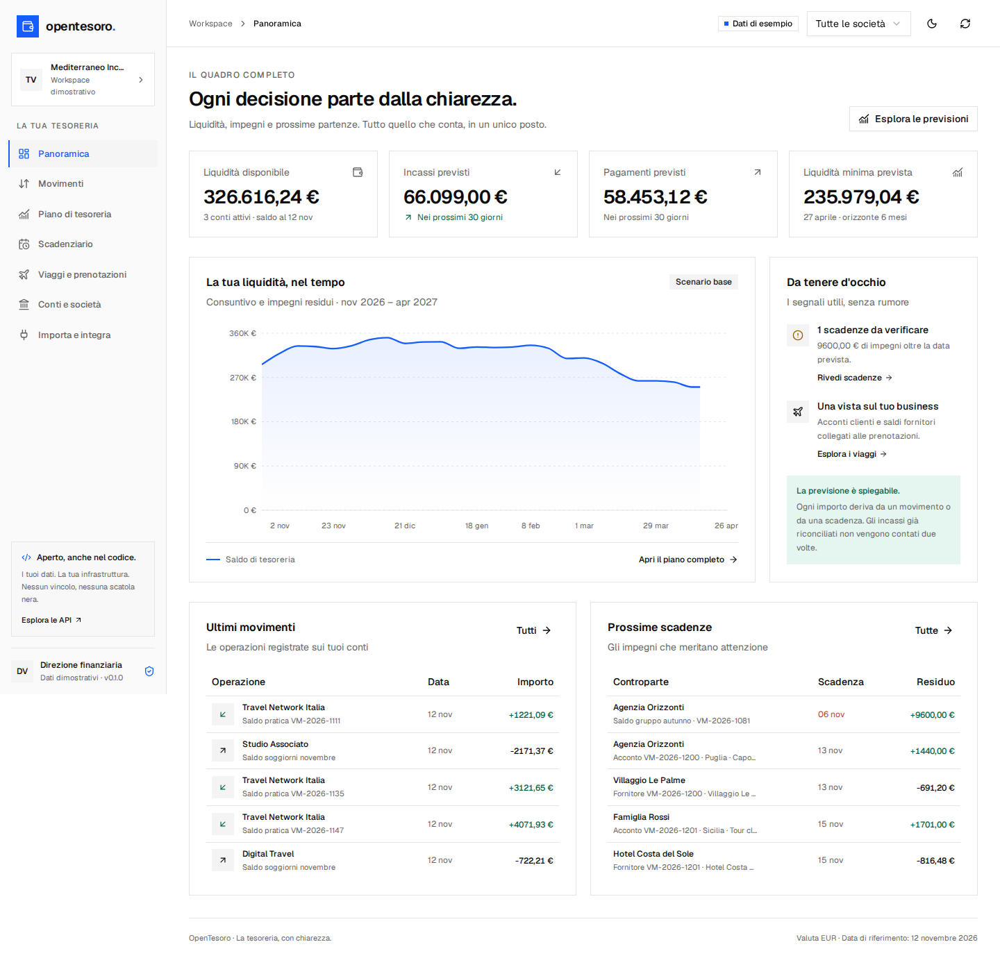

# OpenTesoro

**Open-source treasury for Italian tour operators. A standalone app and an embeddable TypeScript cash-flow engine.**

Bun · SQLite · React · TanStack Router & Query · shadcn/ui · Recharts · MIT

OpenTesoro turns bank movements, customer deposits, final balances and supplier commitments into an explainable liquidity plan. It is an original implementation informed by Agicap's public documentation and authorized read-only product observations. It is not affiliated with Agicap.

**Status: working first milestone, not complete Agicap parity.** The cash-flow engine, persistent API, Italian application, import pipeline, SDK and read-only Agicap API client are implemented. Live bank feeds, payment execution, user management and accounting compliance integrations remain roadmap items. See the [feature matrix](docs/research/parity-matrix.md).

The interface uses a blue shadcn theme, locally served Geist typography, square corners and a saved light/dark preference. The public demo opens without registration and gives each visitor a separate temporary workspace of fictional records. See the [demo guide](docs/public-demo.md) for limits and the difference from a company's persistent installation.



## Run in two commands

Install [Bun](https://bun.sh/) 1.3.13 or newer, then:

```sh
bun install
bun dev
```

Open **http://localhost:5173**. The API runs on **http://127.0.0.1:3000**. A synthetic Italian tour-operator demo is initialized automatically, only when no entities exist. Demo data uses a fixed reference date of **12 November 2026** so examples remain reproducible.

For a single production process:

```sh
bun run build
bun start
```

Open **http://127.0.0.1:3000**. Bun serves the built application and API; no separate Node server, Docker, database service or cloud account is required. Local data persists in `.data/opentesoro.sqlite`.

For an empty business workspace use a **new database path**:

```sh
OPENTESORO_DEMO=false DATABASE_PATH=.data/my-business.sqlite bun start
```

Go to **Conti e società**, create your company, then add an account with its **closed balance at the end of a reference date**. Import subsequent actual transactions; create unpaid obligations separately. Forecast start dates must follow all selected account snapshots. Setting `OPENTESORO_DEMO=false` does not erase an existing demo database.

## Working today

- Italian dashboard with consolidated cash balances, upcoming commitments, overdue items and a liquidity curve.
- Transactions with indexed server pagination, search, account/entity/direction/category filters, categorization and exports.
- Daily, ISO-weekly and monthly forecasts; cash-in/out scenarios, payment delays and minimum liquidity.
- Receivables/payables with aging, partial reconciliation and transaction-allocation guards.
- Travel bookings that generate customer deposit/final balance and supplier advance/final payment schedules atomically.
- Multiple EUR entities/accounts; cash-neutral consolidated transfers and explicit snapshot cutoffs.
- CSV preview and atomic import, Italian dates/decimals, quoted multiline records, repeat-import deduplication and conflict detection.
- Priority categorization rules, audit history, idempotent creates and JSON/CSV exports.
- An independent engine with exact integer minor-unit arithmetic, calendar dates, recurrence expansion and budget-variance functions.
- Fetch-only SDK and a separate read-only connector for the **current** Agicap Public API.

Mixed-currency consolidation is deliberately refused until explicit FX rates and valuation policies are implemented. Booking cash flows are gross contractual cash: no automatic VAT, 74-ter margin-tax, revenue-recognition or F24 calculation is claimed.

## Embed it

```ts
import { buildForecast, parseMoney } from "@opentesoro/engine";

const plan = buildForecast({
  accounts: [
    {
      id: "operating",
      entityId: "tour-operator",
      name: "Operating",
      bank: "Example bank",
      currency: "EUR",
      enabled: true,
      balanceMinor: parseMoney("10000.00"),
      asOfDate: "2026-10-31",
    },
  ],
  transactions: [],
  obligations: [],
  from: "2026-11-01",
  to: "2027-01-31",
  granularity: "week",
});
```

Or use the persistent service:

```ts
import { OpenTesoroClient } from "@opentesoro/sdk";

const treasury = new OpenTesoroClient({ baseUrl: "http://127.0.0.1:3000" });
const data = await treasury.bootstrap();
const forecast = await treasury.forecast({
  from: "2026-11-01",
  to: "2027-04-30",
});
```

Packages are workspace packages exporting TypeScript source; they are not yet published to npm. Copy the workspace into a broader Bun/TypeScript project or consume it as a local dependency. The engine has no framework, filesystem, database or network dependencies.

## API and documentation

The running service publishes **[OpenAPI 3.1](http://127.0.0.1:3000/openapi.json)**. Resource schemas are derived from the actual Zod input definitions. The API uses signed integer cents, ISO calendar dates, paginated lists and structured problem responses.

| Guide                                                             | Contents                                                            |
| ----------------------------------------------------------------- | ------------------------------------------------------------------- |
| [Architecture](docs/architecture.md)                              | Package boundaries, storage design, decisions and integration       |
| [API](docs/api.md)                                                | Endpoints, payloads, pagination, imports and reconciliation         |
| [Engine](packages/engine/README.md)                               | Financial invariants, snapshots, scenarios, recurrence and variance |
| [Agicap connector](packages/agicap/README.md)                     | Official OAuth, read-only methods and integration limitations       |
| [Operations](docs/operations.md)                                  | Configuration, authentication, backups and containers               |
| [Public demo](docs/public-demo.md)                                | Try the app, reset examples, understand session limits              |
| [AWS deployment](infra/README.md)                                 | Reviewed infrastructure, costs, domain setup and deployment         |
| [Verification](docs/verification.md)                              | Executed checks and their limits                                    |
| [Performance](docs/performance.md)                                | Reproducible benchmarks and scope                                   |
| [Research](docs/research/research.md)                             | Product inventory and linked primary sources                        |
| [Current Agicap API](docs/research/current-api.md)                | 19 published contracts, authentication and migration hazards        |
| [Tour-operator workflows](docs/research/italian-tour-operator.md) | Deposits, supplier terms, seasonality, refunds and liquidity        |
| [Roadmap](docs/roadmap.md)                                        | Remaining work toward a broader treasury platform                   |

The current Agicap Public API uses organization-scoped OAuth credentials, not an application login password. Its banking product does not provide general export of PSD2-sourced banking data. OpenTesoro does not create credentials or change your Agicap data.

## Deployment and access

By default, the server binds to loopback. Binding beyond loopback requires `OPENTESORO_API_TOKEN` of at least 24 characters. Generate one with `openssl rand -hex 32`; never commit it. Optional `OPENTESORO_READ_ONLY_TOKEN` must differ from the write token. Configure the browser's token in **Importa e integra → Accesso API del workspace**; it stays in that browser tab's session storage.

The private launcher is a single-organization service. Entity filters are reporting perimeters, not tenant isolation. Place remote installations behind TLS and an appropriate access layer. The separate public-demo launcher uses isolated, temporary visitor databases and refuses private tokens or persistent storage. It is for fictional examples only. See [operations](docs/operations.md).

```sh
# .env: OPENTESORO_API_TOKEN=<a generated random token>
docker compose up --build
```

Docker is optional. The private Compose recipe binds the host port to `127.0.0.1:3000` and persists SQLite in a named volume. The browser needs the configured token. The AWS public demo uses the independently tested `Dockerfile.public-demo`; see the [verification guide](docs/verification.md) for the checks and their scope.

## Development

```sh
bun run check              # strict TypeScript, Bun tests, frontend + server build
bun run test:e2e           # Playwright browser workflows (install Chromium first)
bun run benchmark          # independent financial engine
bun run benchmark:api      # temporary SQLite + request-handler benchmark
```

For an already installed Chrome:

```sh
PLAYWRIGHT_CHROMIUM_EXECUTABLE=/usr/bin/google-chrome bun run test:e2e
```

All tests and examples use synthetic data. Financial regression tests cover exact cents, leap dates, snapshot cutoffs, partial payments, internal transfers, schedule ownership, idempotence, API persistence and SQLite reopen behavior. Performance measurements do not establish superiority to Agicap.

Contributions welcome. Read [AGENTS.md](AGENTS.md), [CONTRIBUTING.md](CONTRIBUTING.md) and the roadmap. Licensed under [MIT](LICENSE). Third-party component notices are preserved in [THIRD_PARTY_NOTICES.md](THIRD_PARTY_NOTICES.md).
