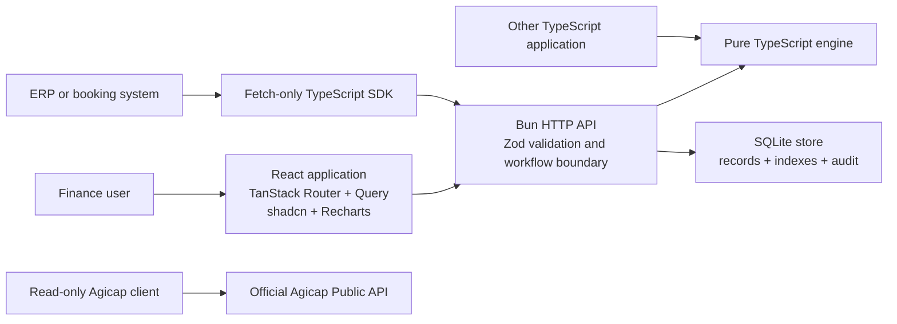

# Architecture

OpenTesoro is an original, EUR-first treasury application and a set of reusable TypeScript packages. The first milestone concentrates on deterministic cash calculations, an auditable local database, an integration API, and an Italian operational interface. It is not a replacement for every product in Agicap's suite.

## Components and dependency direction

The diagram's Agicap client is a separate package. It is not an automatically enabled data feed in the web application. Configuring its environment credentials alone does not cause synchronization.

| Location          | Responsibility                                                                                                                                                          |
| ----------------- | ----------------------------------------------------------------------------------------------------------------------------------------------------------------------- |
| `packages/engine` | Money, calendar dates, forecasts, scenario transforms, outstanding obligations, aging, reconciliation, categorization, travel schedules, recurrence and budget variance |
| `packages/sdk`    | Typed, fetch-only client for the OpenTesoro REST API; no database dependency                                                                                            |
| `packages/agicap` | Current Public API authentication and a small read-only subset of sanctioned Agicap endpoints                                                                           |
| `apps/server`     | HTTP, request validation, persistence, audit, idempotency and atomic business workflows                                                                                 |
| `apps/web`        | Navigation, query cache, forms, charts, transaction/obligation/booking workflows and CSV interchange                                                                    |
| `docs/research`   | Sources, product comparisons, public contract inventory and explicit parity boundaries                                                                                  |

The engine has no runtime dependency on Bun, a browser, database, clock or network. It can be imported into a worker, service, embedded application or test runner. The server supplies data and persists returned changes. TypeScript source exports are intended for a TypeScript-aware runtime or bundler; publishing compiled distribution artifacts is later work.

## ADR 001: Bun server and Vite application

**Decision:** use Bun for the HTTP server, SQLite and workspace tooling, with Vite/React and TanStack Router/Query for the standalone application. Use shadcn's neutral component system and Recharts rather than a proprietary chart library.

The user's preference was a simple standalone TypeScript deployment using technology such as TanStack Start/Bun. The dashboard's main content is authenticated, stateful financial data; search-engine indexing is not a core requirement. Server rendering would add a coupled application runtime without establishing a better calculation engine or operational workflow. A static client bundle plus one Bun server makes the initial deployment explicit and lets the same API support other host projects. Vite proxies `/api`, `/health` and `/openapi.json` during development; production Bun serves the built client and API together.

This choice does not forbid TanStack Start. A future host may render an OpenTesoro page server-side or embed engine/API capabilities in its existing framework. The stable integration boundaries are package exports and HTTP contracts, rather than assumptions about an SSR framework.

## ADR 002: explicit financial semantics

- Monetary values are signed safe integers in minor units. EUR `12345` means €123.45. Receipts are positive and payments negative; forecast outflow totals are reported as positive magnitudes. Exact ratio calculations use checked arithmetic and BigInt intermediates.
- Dates are validated ISO calendar dates, not timestamps guessed in the host timezone. Weeks start Monday.
- An account balance is a **closed end-of-day snapshot** at `asOfDate`. A forecast must begin after every selected account snapshot. Earlier transactions are already reflected in that snapshot; later pre-horizon transactions bridge the opening balance.
- Actual transactions and expected obligations are separate records. Only the residual obligation enters expected cash. `settledMinor` is a nonnegative absolute amount for either cash direction.
- Scenarios scale and move residual expectations; they do not rewrite actual bank movements or contractual due dates.
- Overdue residual expectations are carried into the first forecast date with a warning. This is an exposed timing assumption, not evidence that payment will occur that day.
- Same-day, balanced, fully observed internal transfers can be removed from consolidated inflow/outflow. One-sided, cross-date and filtered transfers remain visible with warnings.
- API records are EUR-only. The reusable engine can operate on one explicitly selected currency at a time and rejects silent mixed-currency consolidation. There is no FX feed or conversion policy.

See the [engine contract](../packages/engine/README.md) for boundary cases and examples. Aging uses currently outstanding balances, not a historical reconstruction of an earlier settlement state. Pure-engine reconciliation cannot serialize concurrent persistence; the API owns that atomic boundary.

## ADR 003: single-file local persistence

The Bun server uses `bun:sqlite`, WAL journal mode, a five-second busy timeout and a schema-version table. The original record schema is created idempotently, followed by migration version 4 for the compact derived lookup projection. Backfill/migration tests preserve canonical financial payloads, revisions and audit history. There is not yet a separate migration CLI or a proven rolling-upgrade strategy.

A `records` table stores validated JSON payloads with extracted collection, ID, entity, account, date and external-key columns. Global date, compound entity/date and account/date indexes support common scopes. A compact `record_lookup` projection owns normalized search text and filter columns; only the selected page joins full canonical JSON. An external-reference uniqueness index protects repeated account transaction imports. This keeps the first schema compact while preserving explicit validation at the HTTP/workflow boundary; it is not a claim that every relationship is enforced by a database foreign key.

Related changes use `Store.atomic()`: reconciliation persists a settlement and the updated obligation together; booking updates replace an unpaid generated schedule atomically; CSV commit either validates the batch or writes nothing. Audit entries, data changes and database revision changes share those transactions. Referenced-record deletion and mutation of settled financial fields are guarded in application code.

The mutation audit retains before/after JSON in SQLite. The public audit route returns summaries of the latest 100 events. It is append-only through the provided application workflows, not cryptographically immutable against a database administrator.

## Query and performance design

Transaction tables use server filtering and limit/offset pagination. Bootstrap deliberately caps transaction records at 5,000 and provides `transactionsTotal`; it is a convenience projection, not a complete transaction export. The full forecast reads all relevant persisted collections and is cached by database revision, range, granularity, scenario and entity selection. The small in-process cache clears at 32 entries and is invalidated naturally by revision changes.

The engine computes daily balances once and projects them into requested buckets. Its minimum liquidity calculation remains daily even for monthly output. A benchmark covers 100,000 synthetic transactions and 10,000 obligations; it does not measure database I/O, HTTP serialization, browser rendering, total hosting cost or comparison with Agicap. See [verification](verification.md) and the separately measured [SQLite/API benchmark](performance.md).

Known scaling boundaries include synchronous SQLite work in the server process, offset pagination, JSON parsing, full-collection forecast materialization, audit growth and bounded bootstrap projections. Postgres adapters, keyset pagination, incremental materialized aggregates and background import jobs should be driven by measured workloads rather than hidden behind performance claims.

## Trust boundary and integration

The private server is a **single-organization installation**. Entities are reporting dimensions, not isolated tenants. Loopback is the default. An optional full-access bearer token and distinct read-only bearer token protect API use; public hosting needs TLS termination and its own operational controls. The role model is not per-person RBAC, SSO, tenant isolation or a bank payment authorization system.

The separate `public-demo-index.ts` launcher wraps the same API and engine with a bounded in-memory Store for each visitor. A random HttpOnly/Secure cookie selects the store; same-origin JSON mutations require a second, in-memory CSRF token. The browser sends that generation token on reads too, so resetting another tab cannot silently switch an open form to a new workspace. Public API responses are never cached. Expiry, quota and service failures remain visible instead of silently creating new data. This is temporary synthetic-demo isolation, not account authentication or authorization for business tenants. The [demo guide](public-demo.md) explains the visitor experience; the [AWS runbook](../infra/README.md) documents the single-process deployment and reset-on-restart behavior.

Agicap research used public documentation and authorized read-only UI inspection. The inspected account was accessible but showed a trial/no active subscription state; that does not verify every paid product or integration. No customer financial records or credentials belong in this repository. The separate adapter has not been verified with live Public API credentials. See [current API research](research/current-api.md), [operations](operations.md) and the [scope roadmap](roadmap.md).
